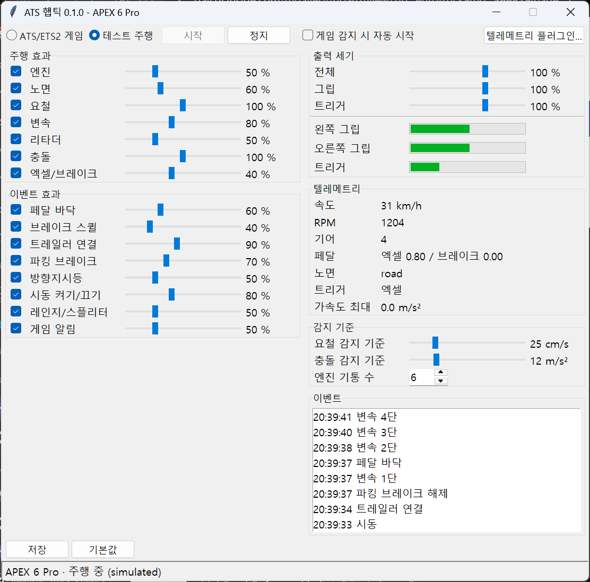
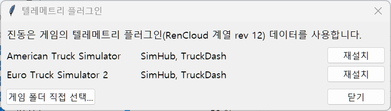

# ATS Haptics for Flydigi APEX 6 Pro

[한국어](README.md) · **English** · [日本語](README.ja.md) · [简体中文](README.zh.md)

Drives the voice-coil (VCM) motors of the Flydigi APEX 6 Pro directly from American Truck Simulator / Euro Truck Simulator 2 telemetry. Unlike X-Haptics, which analyses game audio, the vibration is built from game data such as engine rpm, road surface, suspension and pedals, and every effect can be tuned live in a window.



> The screenshots show the Korean interface. The window follows the Windows display language; pick another one from the language menu at the top right.

## Contents

- [Requirements](#requirements)
- [Install and quick start](#install-and-quick-start)
- [The window](#the-window)
- [Telemetry plugin window](#telemetry-plugin-window)
- [Start with the game (Steam launch option)](#start-with-the-game-steam-launch-option)
- [Updates](#updates)
- [Tuning tips](#tuning-tips)
- [Troubleshooting](#troubleshooting)
- [Known limitations](#known-limitations)
- [Running from source and building](#running-from-source-and-building)
- [License](#license)

## Requirements

- Windows 10/11
- Flydigi **APEX 6 Pro** (wired or 2.4 GHz dongle; Bluetooth and the non-Pro APEX 6 are not supported)
- American Truck Simulator or Euro Truck Simulator 2
- **Turn off the xHaptics Engine** while this runs. It drives the same motors and the vibrations would mix. For the Space Station web page, closing its tab is enough.

## Install and quick start

1. Download `ATSHaptics-<version>.zip` from [Releases](../../releases) and unpack it anywhere.
2. Run `ATSHaptics\ATSHaptics.exe`. There is no installer.
3. If no usable telemetry plugin is found for your game, the [plugin window](#telemetry-plugin-window) opens by itself. Press **Install**.
4. First check that the controller vibrates with **Test drive** → **Start** (a 60-second scenario, no game needed).
5. Choose **ATS/ETS2 game** → **Start** and launch the game. The app takes the controller when the game starts and releases it when the game ends.

To have the window open with the game every time, set the [Steam launch option](#start-with-the-game-steam-launch-option).

## The window

Rest the pointer on any slider, switch, button or value for a tooltip explaining what it does. The tooltips are short versions of the tables below.

### Top bar and output control

| Item | Description |
|---|---|
| **Input: ATS/ETS2 game** | Builds vibration from the game's telemetry. The controller is only used while ATS (`amtrucks.exe`) or ETS2 (`eurotrucks2.exe`) is running. |
| **Input: Test drive** | Plays a fixed 60-second delivery run on a loop, no game needed: engine start → trailer coupling → wheelspin at launch → acceleration and shifting (splitter, range) → motorway (left signal, left pothole, right rumble strip) → concrete joints → gravel (right signal) → wooden bridge → snow → wheelspin on ice → downhill retarder and engine brake → hard stop (wheel lock, brake squeal) → toll gate → hazards on, reversing into the dock with a bump (impact) → parking brake → trailer uncoupling → delivery complete → engine off. The trailer wheels hit each bump 0.45 s after the truck. Use it to check or tune effects. |
| **Test drive ▾** | Picks what the test drive plays. **Default 60 s** is the run above; **Highway 4 min**, **City 2.5 min** and **Mountain 3 min** are real driving where effects come together (merging and cruising, lights and turns, a pass). **Replay debug log…** plays a drive recorded by the debug log again with the current settings, to feel a moment from the game again or compare settings. |
| **▶ Start / ■ Stop** | One button. The green **Start** begins output and turns into a red **Stop**. Stopping turns the motors off and releases the controller. The input (game/test drive) cannot be changed while running. |
| **Start when the game runs** (switch) | When on, a stopped window starts by itself the moment the game runs. If you stop it yourself during a game, it stays stopped until that game ends. The switch is saved immediately. |
| **GitHub ↗** | Opens this program's GitHub repository (source, releases, questions) in the browser. |
| **Language menu** (e.g. `English ▾`) | Picks the interface language: 한국어, English, 日本語, 简体中文, Deutsch, Français, Español, Português (Brasil), Polski, Русский. The window redraws at once, tuning and the running session are kept, and the choice is saved immediately. Until you pick one, the Windows display language is used, or English if it is not in the list. Status messages and the event log follow the same language; lines already logged stay as they were. |
| **Telemetry plugin** | Opens the [plugin window](#telemetry-plugin-window). |
| **Update x.y.z** | Only appears when GitHub has a newer release. See [Updates](#updates). |

### Output level and meters

The **final strength** sent to the controller, applied after all the effect levels below have been mixed. Range 0–150%, default 100%.

| Item | Description |
|---|---|
| **Master** | Applies to the grips and the trigger. |
| **Grip** | Applies to the left and right grip motors only. |
| **Trigger** | Applies to the trigger motors only. 0% turns trigger vibration off completely. |

At higher levels a soft limiter keeps overlapping effects from clipping harshly. Above 100%, weak effects get stronger while effects that are already strong barely change.

**Motor calibration…** (below the meters) matches by feel how differently the motors respond across frequencies. The motors ring hardest near 65 Hz (grips) and 100 Hz (triggers), so the same drive feels different at each frequency (the engine weak at idle and strong only at cruising revs, for one); this corrects it frequency by frequency. Two neighbouring frequencies (say 80 Hz and 65 Hz) play one after the other in random order and you pick the one that felt stronger: if one felt even slightly stronger pick it, and if you really can't tell pick either. Not being able to tell means they are nearly equal, so it doesn't skew the result. The answers close in on the strength at which the two feel the same, in 3 dB steps and then 1.5 dB once your answer has turned, working outward from the reference (65 Hz for the grips, 100 Hz for the triggers) neighbour by neighbour. That is 9 frequencies for the grips (30–250 Hz) and 7 for the triggers (50–250 Hz), 3–5 minutes per motor. You can answer with the pad's buttons: D-pad ← or LB first, → or RB second, X replay, B stop (on the keyboard ← → or 1 2, R, Esc); presses count even while the tones play. Under each button in the window are the pad and keyboard buttons that give the same answer. Once a motor is done it is saved as `eq` in `config.json` and applies to every effect, frequency by frequency, from the next start (×0.25–×4). A grip curve lifts most frequencies 3–4×, so the whole curve plays at 0.4×: it shifts the balance between frequencies while the grips stay about as strong overall as without it, and strong hits don't get squashed at the output limit. The resonance a curve shows (where the least drive is needed) also rings on for tens of milliseconds after every short pulse and rounds taps into a soft hum, so each output passes through a filter that cuts that resonance by as much as the curve says, and each effect is lifted back by the same amount at its own frequency. Steady vibrations keep their strength; short ones stop as sharply as they were shaped. Until you measure, a default matched by hand on the developer's APEX is used, and **Clear calibration** goes back to it. Only the motor you measured yourself (grips or triggers) changes. It opens only while the output is stopped, and the Start button and auto start on a game launch wait while it runs.

The **meters** show what actually goes to the left grip, right grip and trigger. Use them to see at which stage a weak or missing vibration gets lost.

### Driving effects

The switch on the left turns each effect on or off. An effect that is off is greyed out but keeps its slider and output, so turning it back on restores it.

**Output to** on the right picks where each effect vibrates: **Grip** (blue) | **Trigger** (orange) | **Both** (violet), for driving and event effects alike. The slider takes the colour of the chosen output, so you can see at a glance what goes where. Picking an output on an effect that is off turns it back on. "Default output" in the tables is the initial setting. Sided effects (road, bumps, turn signals) sent to the trigger are summed into it; trigger effects sent to the grips play on both grips. On the trigger, a pedal's effects play on that pedal's trigger only: the brake's (the brake side of **Throttle/brake**, **Brake squeal**, **Pedals** on the brake) on the left, the throttle's (the throttle side of **Throttle/brake**, **Pedals** on the throttle) on the right. When other effects are sent to the trigger too, or both pedals' effects overlap, both triggers play the same vibration. Changes apply at once and are kept when you **Save**.

**▶** at the end of each row plays that effect alone for a few seconds, at its current level and output and with the motor calibration, even while it is switched off. Bumps, Rumble strips and Turn signals play on the left, then on the right, so you can check that the sides come apart; the meters show it too. **Throttle/brake** and **Pedals** play the throttle (right trigger), then the brake (left trigger). With the output stopped it takes the controller only for those seconds; while the output runs it plays in place of the driving vibration.

| Effect | Default (range) | Default output | What it does |
|---|---|---|---|
| **Engine** | 10% (0–200) | Both grips | The engine firing frequency (rpm ÷ 60 × cylinders ÷ 2, so rpm ÷ 20 for a six) plus its second harmonic. Stronger with more throttle and higher rpm. Each firing differs from the last (±18%) and the cylinders never fire quite alike: most unevenly at idle, where it lopes, and less as rpm and load rise, though as in real engine recordings it never fully evens out. Under load a third harmonic makes it harsh. With 8 cylinders it is lumpy like a recorded V8: the cylinders differ far more, and that stays at any rpm and load instead of loping more at idle. When the truck stops, the idle grows up to 3 times stronger so the engine is felt while standing (revving it up adds no more than usual). Nothing while the engine is off. |
| **Road** | 50% (0–200) | Left/right grip separately | Strength and feel come from the surface under the wheels and the speed, plus fine suspension movement. Strength runs ice < asphalt < concrete < snow < wood < metal < grass < dirt < gravel. The hand tells textures apart by how they move more than by pitch, so each surface moves its own way: asphalt is a broad, even hiss, concrete knocks at a joint every 4.6 m (about 5 a second at 80 km/h), wood planks drum and a steel grating hums near 150 Hz, dirt and grass heave slowly, and gravel churns fast in a narrow band. Pitch follows the low end of real tyre recordings (grass 200 Hz, ice 160 Hz, metal 130 Hz, snow 110 Hz, asphalt 100 Hz, concrete 90 Hz, gravel 85 Hz, wood 75 Hz, dirt 60 Hz), lower when slow (60% at a standstill). Gravel, dirt, snow and coarse paving add the click of loose stones, mostly small with now and then a big one (about 3 per metre on gravel). Where the suspension works hard the cab rattles: 55 Hz knocks, up to 40 a second. It also tells paving apart (smooth `road_smooth` < ordinary road < coarse `road_coarse` < dirt-covered `road_dirt`). |
| **Bumps** | 100% (0–200) | Grip on the wheel's side | A hit when the suspension moves suddenly (potholes, kerbs, joints). Shaped after recorded bumps, it follows the size of the hit: a small joint is a short, high tap (65 Hz, 0.025 s), a big pothole a low, heavy thud (40 Hz, 0.06 s), and after a big hit the cab rattles softly for about 0.3 s. Left wheels go to the left grip, right wheels to the right grip. Trailer wheels follow at half strength and a little higher (+10 Hz). A suspension reading the game sends for a single frame and takes back on the next is not a bump, so bumps land one frame late (about 17 ms at 60 fps). When the cab rocks on its mounts, as on a dirt road, a smooth 45 Hz hum follows its sway: it starts at a tilt acceleration of 0.06 rad/s² and is full at 0.6, the grip on the side the cab leans to gets all of it and the other about half, and they swap as the cab rocks back. On pavement it hardly ever sounds. |
| **Rumble strips** | 80% (0–200) | Grip on the wheel's side | A "brrrrt" when you drive onto a centre-line or shoulder rumble strip. It is detected from the per-wheel surface the game reports (`rumble_stripe`), so it works even when the suspension barely moves. The frequency follows the groove spacing (about 30 cm) and speed: about 83 Hz at 90 km/h. As in recorded rumble strips it is close to a pure tone, with every other groove landing harder. Trailer wheels on the strip alone give half strength. |
| **Wheelspin** | 70% (0–200) | Both grips | A rough, grinding 45 Hz when the driven wheels clearly turn faster than the truck under throttle (ice, snow, mud, hard launches), chattering at 13 Hz like a tyre gripping and slipping. Wheels locked by braking are handled by **Throttle/brake**. |
| **Gear shift** | 60% (0–200) | Both grips | A "clunk" on every gear change, shaped after real Eaton Fuller shift recordings: a soft knock as the lever leaves the gear (the driving vibration dips from here), then, 0.14 s after the change, a crisp 140 Hz clack as the next gear goes in, with a short ring from the gearbox. It keeps the recordings' timing. Works with automatic gearboxes too. Set **Gearbox** to Torque converter for a soft push instead (see **Gearbox** below). The clack also comes with a tick you hear from the pad (a single strong sample, barely felt). |
| **Retarder** | 30% (0–200) | Both grips | A hum proportional to the retarder stage that rises in pitch with speed (40 Hz standing, 65 Hz from 90 km/h) and fades at low speed. The engine brake is a knock at the engine's firing rate (rpm ÷ 20 for six cylinders), stronger at higher rpm and gone while you press the throttle. |
| **Impact** | 100% (0–200) | Both grips | A strong 50 Hz pulse when acceleration jumps sharply (collisions, big hits). The threshold is set under [Detection](#detection). |
| **Throttle/brake** | 20% (0–100) | Trigger (the pressed pedal's) | Follows the pedal you are pressing. On the throttle, 100 Hz that grows with pedal travel. On the brake, a 110 Hz pulse chopped at 12 Hz when the wheels lock; without lock, a light vibration proportional to speed and braking. |
| **└ Engine pulse** | 80% (0–100) | Follows Throttle/brake | How much the throttle trigger swells with the engine firing rhythm. 0% is steady with no engine feel in the trigger; higher makes the rhythm clearer (older versions were fixed at 80%). The pulse follows the same firings as the engine vibration on the grips, so the uneven idle and each firing's slightly different strength come through the trigger too. No effect on the brake side. |
| **Ease at steady speed** | 60% (0–100) | - | A vibration that never changes soon goes unnoticed and only tires the hands, so while what drives them holds steady, **Engine** (rpm and load), **Road** (surface, speed and roughness) and **Throttle/brake** (the pedal) fade by this amount (about half in 6 s, nearly all in 25 s). Speeding up or slowing down, shifting, a new surface or moving a pedal brings full strength back at once. Speed drifting within about 3.6 km/h on cruise control and a finger resting on the trigger do not count as changes. Fully faded, 60% is about −8 dB and 80% about −14 dB; on a recorded drive of about 19 minutes, 60% took the road about 6.6 dB down overall and 40% about 3.9 dB. 0% disables it. Bumps, rumble strips and the wheel-lock pulse are moments, not a bed, and never fade. |

### Event effects

| Effect | Default | Default output | What it does |
|---|---|---|---|
| **Pedals** | 60% | Trigger (the pressed pedal's) | A short "thud" the moment throttle or brake reaches the floor (97% or more) |
| **Brake squeal** | 40% | Left trigger | A 230 Hz squeal while braking gently to a stop below about 14 km/h. Like the recorded ones it comes in separate squeals of 0.15–0.5 s, each a little off the last in pitch |
| **Trailer coupled** | 90% | Both grips | As in recorded couplings, the fifth wheel clatters for about 0.6 s when coupling (a knock every 20–40 ms, the hardest one somewhere different each time); a thump followed by an air hiss when uncoupling. Every knock also ticks audibly from the pad. |
| **Parking brake** | 70% | Both grips | Set: a "clunk", then the spring brakes venting (swelling over 0.15 s, dying over most of a second). Released: a "thunk", then a short puff 0.3 s later |
| **Engine start/stop** | 80% | Both grips | Follows the start and stop recordings of two engines. On start the starter engages with a knock, compression knocks go on for about a second, then the engine catches, firing faster and faster into a "vroom" (strongest 0.2–0.3 s after it catches). On stop it fires on at the idle's beat for about 0.3 s, then drops away and putters out within a second. Assumes the game reports the engine on as cranking starts. |
| **Range/splitter** | 70% | Both grips | A "click" when you use the range selector or splitter switch of an H-shifter (140 Hz for the range, a low 60 Hz for the splitter), then, as in the recordings, the gearbox shifting over on air with a "clack" 0.13–0.17 s later (170 Hz): as hard as a gear shift for the range, 12 dB softer for the splitter. Silent with automatic or sequential shifting. The click and each clack also tick audibly from the pad. |
| **Air brake** | 30% | Both grips | Letting go of the brake pedal after more than 0.3 s vents the brake chambers: a soft 50 Hz "thump", then a short "pssht" (swelling over 0.04 s, dying over about 0.25 s). Louder the harder you braked. It comes with every release, so it does not duck the driving effects. The pssht plays at 300–450 Hz, which the pad sends toward you clearly, so you hear it from the pad more than feel it. |
| **Turn signals** | 50% | Grip on the signalling side | A short, high "tick" with every blink, like the relay's (190 Hz, a few ms). Each blink also ticks audibly from the pad, like the relay (a single strong sample, barely felt). |
| **Game alerts** | 50% | Both grips | A double "tap-tap" on toll gates, fines, refuelling, finished deliveries, ferries and trains |
| **Duck for events** | 70% (0–100) | - | How much an event effect (gear shifts and impacts included) briefly lowers the driving vibration on the same output (engine, road, rumble strips, wheelspin, retarder, throttle/brake) so the event is not drowned out. At 70%, driving vibration drops to 30% at the peak of the event and recovers within about 0.1 s. 0% disables it. Bumps come from the road itself, so they do not duck the driving vibration. |

All event effects range from 0 to 200%. Air brake, turn signals and game alerts are what a real driver hears rather than feels, so they sit at the bottom with lower defaults.

### Detection

| Item | Default (range) | Description |
|---|---|---|
| **Bump threshold** | 20 cm/s (5–100) | A bump pulse fires when the suspension suddenly moves faster than this. Lower reacts to small bumps, higher only to big hits. If the truck rides rough, the threshold rises above this by itself. |
| **Impact threshold** | 12 m/s² (4–40) | An impact pulse fires when acceleration changes by more than this from one game frame to the next. Keep it well above the **Peak accel.** you see under [Telemetry](#telemetry) in normal driving. |
| **Engine cylinders** | 6 (4–12) | Used for the engine vibration frequency; 8 also gives it a V8's lumpy beat. Most stock ATS trucks have an inline six; set 8 for trucks such as the ETS2 Scania V8. Telemetry does not report the cylinder count, so it is set by hand. |
| **Gearbox** | AMT / manual | How a gear change feels. **AMT / manual** is the clack above (gearboxes such as the Eaton Fuller or DT12). With a **Torque converter** (Allison) the drive never lets go as the next gear takes hold, so there is no lever and no clack: a rounded 45 Hz push, at its height 0.06 s in and gone within 0.4 s, and the driving vibration does not dip. The deeper the throttle, the firmer it is (4.5 times as strong floored as with your foot off); shifting off the throttle, it is barely there. No recording of one was available, so this feel is reasoned rather than measured. Telemetry does not report the gearbox, so it is set by hand. |

### Telemetry

What the game is sending right now. Use it to check that data arrives when the vibration feels wrong.

| Item | Description |
|---|---|
| **Speed / RPM / Gear** | Straight from the game. Reverse gears are negative, neutral is 0. |
| **Pedals** | Throttle and brake input (0–1). Values the game applies itself, such as cruise control, are not included. |
| **Road** | The game's internal name of the surface under the first wheel (e.g. `road`, `gravel`, `grass`). |
| **Trigger** | The pedal the trigger channel is following right now (throttle/brake/-). |
| **Peak accel.** | The highest horizontal acceleration over the last 0.1 s. Useful for setting the impact threshold. |

### Event log

Gear shifts, impacts, floored pedals, trailer, parking brake, turn signals, engine start/stop and game alerts are logged with the time, and so are controller connection problems. The latest 50 entries are shown.

### Presets

The **Presets** row under the output controls switches the whole tuning in one click. Each preset keeps its own levels, thresholds, on/off states, outputs, cylinder count and gearbox. Use them when you change vehicles, such as your truck and the car of Trip mode.

- **＋ New preset from current**: keeps the current settings (unsaved changes included) under a name and switches to that preset.
- **A preset button**: switches to it at once, even mid-drive, and the next start opens with it too. The preset in use is lit blue. With unsaved changes you are asked whether to save them first.
- **Save**: also saves into the preset in use.
- **Right-click**: rename, delete. Deleting leaves the current settings as they are.

Presets live under `presets` in `config.json`.

### Save, defaults, debug log and timing

| Item | Description |
|---|---|
| **Save** | Saves the sliders, on/off states and outputs (grip/trigger/both) to `%APPDATA%\ATSHaptics\config.json`. While a preset is in use, it is saved there too. While there are unsaved changes the **Save** button turns blue and "Changed · not saved" is shown, and closing the window asks whether to save. |
| **Defaults** | Resets every level, threshold and output to its default and turns every effect on. Saving is a separate step. |
| **Debug log** (switch) | When on, every time the app takes the controller (Start, the game launching, reconnecting after a drop) it writes each 8 ms block sent to the controller as one line in `%APPDATA%\ATSHaptics\logs\blocks-<date>-<time>.csv`. Columns: time (to the ms), gap since the previous block (over 8 ms means output ran late), the trigger(s) it played on (LEFT/RIGHT/BOTH, MUTE when quiet), peak trigger / left grip / right grip value (full scale ±127 for the grips, ±102 for the trigger), what the game reported (speed, rpm, gear, throttle, brake, retarder, engine brake, park brake, blinkers, range/splitter, the surface under each side, and every wheel's suspension on a new frame), the app's own state (engine, road and trigger levels, the steady fade, ducking, the effects still ringing), and the events of that block (including settings changes and pauses). A `.json` of the same name keeps the version, settings and motor curves the log started with. About 80 MB per hour; only the latest 10 logs are kept. The switch is saved at once and takes effect right away, even mid-drive. The event log shows the file name when recording begins. |
| **Log folder ↗** | Opens the debug log folder in Explorer. |
| **Last session: late frames / max ms** (right) | How often the previous session missed the 8 ms output period, and the worst delay. Close to 0 is normal. |

### Status line

Shown to the right of the output controls as `controller status · telemetry status`. The dot in front is green while vibrating, yellow when started but not yet holding the controller (waiting for the game and so on), red on errors and grey when stopped.

| Message | Meaning and what to do |
|---|---|
| `Stopped` | Not outputting. |
| `Controller not in use · Waiting for the game (ATS/ETS2 not running)` | Started, but the game is not running yet. The controller is not held. |
| `APEX 6 Pro · Driving (Local\…Telemetry)` | Working normally. The name in brackets is the shared memory of the plugin being read. |
| `… · Paused / menu` | The game is paused or in a menu. Vibration stops. |
| `… · Telemetry stalled (minimized or loading)` | Game data has not updated for over 0.3 s, e.g. while loading or with the window minimized. |
| `… · Waiting for telemetry (game loading or no plugin)` | The game is running but there is no telemetry. If it persists after loading, install the plugin. |
| `No telemetry: … plugin revision N (supported: 12) …` | The installed plugin's data layout revision does not match. Install from the plugin window. |
| `No controller (check the cable or 2.4G dongle and the power) · retrying in 2 s` | The controller was not found. Check the connection; the app retries every 2 seconds. |
| `Controller hidden: started by Steam, so Steam Input hides the pad …` | In a process started by Steam (for example ATSHaptics added as a non-Steam game), the pad is invisible while Steam Input is on for the game. Start the window yourself or use the launch option below. |
| `Controller not responding (press a button to wake it if it is asleep)` | The dongle is present but the controller does not answer. Press a button to wake it; the app continues by itself. |
| `Controller disconnected (…)` | The connection dropped while driving. The app continues by itself once it is back. |
| `Game closed, controller released` | The game ended and the controller was released. The app waits for the next launch. |
| `Error: …` | A problem that does not recover by itself (for example a model other than the APEX 6 Pro). Details go to `%APPDATA%\ATSHaptics\logs\error.log`. |

## Telemetry plugin window



Vibration is built from the data exported by the telemetry plugin installed in the game (the RenCloud scs-sdk-plugin family, data layout rev 12). This window finds the ATS/ETS2 install folders in your Steam libraries and shows which plugins are in `bin\win_x64\plugins`.

| Shown | Meaning |
|---|---|
| `RenCloud`, `TruckDash` | Compatible. Nothing to do. |
| `SimHub` | The SimHub plugin. Its data layout is not verified, so it is shown as "compatibility unknown". |
| `No telemetry plugin` | Press **Install**. |

- **Install / Reinstall:** copies the bundled RenCloud `scs-telemetry.dll` (v1.12.1, MIT) into the game's `plugins` folder. Other plugins are left alone. If the game is running, it takes effect from the next launch.
- **Choose game folder…:** for installs outside Steam or ones that were not found, point to the game folder (the one containing `bin\win_x64\amtrucks.exe` or `eurotrucks2.exe`).
- If the game folder is not writable, the error dialog names the file to copy and where. Run as administrator or copy it yourself.
- With a plugin present, the game may show an "Advanced SDK features" notice at startup. It means the telemetry plugin loaded correctly.

## Start with the game (Steam launch option)

In your Steam library, open the game's **Properties → General → Launch options** and enter the following, with the path changed to where you unpacked the app:

```
"C:\Tools\ATSHaptics\ATSHaptics.exe" --launch %command%
```

- When the game starts, the window **opens minimised and starts by itself**. When the game ends, the window closes too, asking first if there are unsaved changes.
- Nothing stays resident. The game is checked every 2 seconds only while the window is open.
- Put any existing launch options (e.g. `-nointro`, `-rdevice dx11`) after `%command%`.
- If the window is already open, no second window appears; if that window is stopped, it starts with the **ATS/ETS2 game** input (regardless of the auto-start switch). That window does not close when the game ends.
- The window is started outside the process Steam launched (through WMI). Steam injects its overlay into the game and its child processes and, with Steam Input on for the game, hides the pad from them. This way the app gets the pad even with Steam Input on.

## Updates

When the window opens it checks GitHub for the latest release. If there is a newer one, an **Update x.y.z** button appears at the top right. Offline, the check is skipped quietly.

- The button shows the release notes; on confirmation it downloads the zip and checks it against the SHA-256 published on GitHub.
- After the download the window closes (asking first about unsaved changes). Once the program has fully exited, the new files are copied over the install folder and the new version starts. Settings (`%APPDATA%\ATSHaptics`) are kept.
- The install folder is backed up first; if copying fails, the previous version is restored and started. If the program has not exited after 2 minutes, nothing is changed.
- No updates while the game runs: when started through the Steam launch option, the executable stays in use until the game ends. Quit the game, open the window again and update.
- If the install folder is not writable (e.g. `Program Files`) or you run from source, only the release page is opened.
- Keep the `_internal` folder in the install folder: the update replaces only an install that has it, and otherwise opens the release page. Up to 0.19.0 it held the Python runtime; updating to 0.20.0 leaves a single note in it.
- The install log is kept at `%TEMP%\ATSHaptics-update-<version>\unpacked\apply-update.log`.

## Tuning tips

1. Start with **Test drive** and set the master level while watching the meters.
2. In real driving, toggle effects one at a time to compare. Switches apply immediately.
3. If vibration tires your hands on long hauls, first raise **Ease at steady speed** to 70–90%: it takes more out of vibration that never changes and leaves the moments when something changes alone. If that is not enough, lower the effects that never stop, such as **Road**, **Throttle/brake** and **Engine**. If the road feels too empty on highways instead, bring it down to about 40%.
4. If the trigger is too much for your fingers, lower **Output level → Trigger**. The balance between effects stays the same.
5. To feel an effect in your fingers (e.g. the engine in the throttle trigger), set its output to **Trigger** or **Both**.
6. If bump pulses come too often on paved roads, raise the **Bump threshold**.
7. If events such as turn signals or gear shifts get lost while driving, raise **Duck for events** or lower **Engine** and **Road**. If you dislike the driving vibration dipping on every event, lower the ducking.
8. If the engine feels weak at idle and strong only when cruising, or high ticks such as the turn signals feel faint, match the motors across frequencies with **Output level → Motor calibration…**.
9. When you like it, press **Save**.

## Troubleshooting

**No vibration at all.**
- Check that the status reads `APEX 6 Pro · Driving`. For any other message, see the [status table](#status-line).
- Turn off the xHaptics Engine if it is running.
- If the meters move but nothing vibrates, check the output levels and the connection type (Bluetooth is not supported).

**No vibration after starting the game until I restart the program.** A bug in 0.1.0. When the game or Steam initialises the gamepad while loading, or the controller re-pairs with the dongle after sleeping, the controller firmware loses its motor setup while data transfers keep succeeding, so no retry happened. The motor setup is now re-sent periodically while outputting (every 1 s when silent, every 4 s while vibrating), and it recovers within seconds.

**Telemetry values only show `-`.**
- Check whether the game is paused or in a menu.
- In the plugin window, check for a compatible plugin (RenCloud, TruckDash); if there is none, install it and restart the game.

**Both triggers vibrate.** The pedal effects play only on the pressed pedal's trigger (brake left, throttle right). Both vibrate when another effect (the engine, say) is sent to **Trigger** or **Both**, or when both pedals' effects overlap: there is only one trigger vibration, so then the same one plays on both. If they always vibrate together, check the controller firmware. See [Known limitations](#known-limitations).

**The window does not open when I start the game from Steam.**
- Check the path and quotes in the launch option.
- If a window is already open, no new one appears (check the taskbar).

**The text is in the wrong language.** Pick one from the language menu at the top right. The choice is saved as `app.language` in `config.json`; delete that value to follow the Windows display language again.

**I want to reset the settings.** Press **Defaults** → **Save**, or delete `%APPDATA%\ATSHaptics\config.json`.

**The vibration sometimes kicks oddly.** Turn on **Debug log** at the bottom, press **Start** again, and note the clock time when it happens. Around that time, a `gap_ms` well above 8 means output ran late; a sudden jump in `trigger`/`left_grip`/`right_grip` means this program sent it. If both look normal, the cause is outside the program (radio interference, vibration from the game or Steam Input, firmware). Send the file and the time when you report it.

**I want to collect information for a report.** Run `ATSHaptics.exe --selftest`; it writes the version, controller detection and game/plugin detection to `%TEMP%\ATSHaptics-selftest.txt`. If the status showed `Error: …`, also send `%APPDATA%\ATSHaptics\logs\error.log`, where unexpected errors are logged with the time.

## Known limitations

- The trigger gets one vibration at a time, so the left and right triggers cannot play different vibrations at once: one plays alone, or both play the same. Which side plays is picked with the controller's motor setup command, verified on controller firmware 9.0.6.8 with blind checks (`tone.py grip-target`, `tone.py trigger-side`); older firmware is untested. The grips are independent.
- The controller plays its 1 kHz samples as steps, with nothing smoothing them, so every vibration comes with a 0.5–3 kHz buzz you can hear; that cannot be removed. The continuous effects (engine, road, rumble, wheelspin, retarder, trigger) are filtered above 300 Hz, which takes out the 300–500 Hz they put out that the ear hears and the hand barely feels, and the rough beat near 490 Hz. Each is lifted back at its own frequency, so its strength stays the same. Short effects are not filtered, so they stop sharply.
- Telemetry carries no engine cylinder count, gearbox type, wiper speed and the like, so those effects are set by hand or left out.
- Based on unofficial reverse engineering; controller firmware updates may change the behaviour.

## Running from source and building

The released program is built from the Rust code at the top of the repository (`Cargo.toml`, `src\`, `ui\`). It needs [Rust](https://rustup.rs) (stable, MSVC toolchain).

```powershell
cargo run --release --bin ATSHaptics                        # window
cargo run --release --bin ats_haptics -- --monitor          # command line: --simulate, --scenario highway|city|mountain, --replay <log.csv>, --exit-with-game, per-effect levels
cargo run --release --bin replay -- <log.csv> --knocks 0.5  # run a debug log through today's synth and compare it with what was logged
cargo test                                                  # bit-for-bit comparison with the Python implementation (below), window drawing, translations
powershell -ExecutionPolicy Bypass -File build.ps1          # dist\ATSHaptics-<version>.zip (source and licenses included)
```

The version is kept in one place, `version` in `Cargo.toml`. The executables, the zip's name and the Python `version.py` all read it from there.

The Python files in `python\` are the implementation released up to 0.19.0. They stay as the reference the Rust version is checked against, and the pad diagnostics (`tone.py`) exist only there.

```powershell
python -m venv .venv
.\.venv\Scripts\python.exe -m pip install -r python\requirements.txt
.\.venv\Scripts\pythonw.exe python\app.py                   # window (or python\start_gui.cmd)
.\.venv\Scripts\python.exe python\ats_haptics.py --monitor  # command line, same options as the Rust one
.\.venv\Scripts\python.exe python\tone.py probe             # diagnostics: probe | tone | sweep | walk | route-test | diag | split | trigger-side | calibrate | pad-sound | strength
.\.venv\Scripts\python.exe python\tone.py trigger-side      # blind check that the trigger follows its side (answered on the pad), results in logs\trigger-side-*.txt
.\.venv\Scripts\python.exe python\tone.py calibrate         # the window's motor calibration in a console, --reset clears it
.\.venv\Scripts\python.exe python\tone.py pad-sound --record "<input>"  # record the sound the pad makes with a microphone (16 sines at 5 strengths, taps) to sound sample\pad-sound\
.\.venv\Scripts\python.exe python\tone.py strength          # blind check whether grip vibration past 20% feels stronger or only rougher (answered on the pad), results in logs\strength-*.txt
python tools\pad_sound_analyze.py <recording.wav>           # analyse that recording; tools\synth_bands.py: the synth output's bands and strength (tools\requirements.txt)
.\.venv\Scripts\python.exe tools\make_golden.py             # the reference data cargo test compares against, into tests\golden-data\ (about 460 MB)
.\.venv\Scripts\python.exe python\i18n.py                   # translation check: missing, unused or {placeholder}-mismatched strings
.\.venv\Scripts\python.exe -m unittest discover python      # Python regression tests (python\tests\)
```

Interface strings use the Korean source text as the key (`t("정지됨")` in code, `@tr("정지됨")` in `.slint`). The translations are kept in `MESSAGES` in `python\locales\<language>.py`; a missing translation falls back to English, then Korean. After changing or adding a string, run `python\i18n.py` to check that every language table has it, then regenerate the Rust tables with `tools\export_locales.py` (translations) and `tools\export_gui_texts.py` (slider rows, tooltips, menus).

Steam launch option for your own build: `"<repo>\target\release\ATSHaptics.exe" --launch %command%`

Folders: `src\` and `ui\` hold the Rust app; `resources\` what the executable embeds (the translation tables and the telemetry plugin DLL); `python\` the Python implementation; `tools\` development tools (regenerating the translation tables and the reference data, collecting licenses, analysing recordings); `docs\` screenshots and notes (`docs\rust-port.md`: notes on the move to Rust, in Korean).

Structure (the `.rs` files are all in `src\`; most pair with the Python file of the same name):

```
ATS ─(scs-telemetry shared memory)─▶ telemetry.rs ─▶ effects.rs (1 kHz synthesis) ─▶ apex6.rs ─(HID 0x57, 8 ms)─▶ APEX 6 Pro
                                       runner.rs: a drive, for the window and the command line
                                       gamewatch.rs: game detection     plugin_install.rs: plugin detection/install
                                       updater.rs: GitHub release check and self-update
                                       i18n.rs + resources\locales, resources\lang: interface languages    ui\*.slint + bin\app\: window, tooltips
                                       blocklog.rs, replay.rs: debug log and replays    errorlog.rs: unexpected error log
                                       preview.rs: each effect's ▶ test   calibrate.rs: motor calibration
```

## License

GPL-3.0-or-later (`LICENSE`). The APEX 6 protocol implementation is ported from [ApexSenseBridge](https://github.com/ReynArts/ApexSenseBridge) (GPL-3.0-or-later), and the bundled telemetry plugin is [RenCloud/scs-sdk-plugin](https://github.com/RenCloud/scs-sdk-plugin) (MIT). The window uses [Slint](https://slint.dev) under GPL-3.0. See [THIRD_PARTY_NOTICES.md](THIRD_PARTY_NOTICES.md) for details; the license texts of every Rust library in the executables are in the release zip's `THIRD_PARTY_LICENSES.txt`. The release zip carries the corresponding source in its `source\` folder.

Unofficial and not affiliated with Flydigi or SCS Software.
