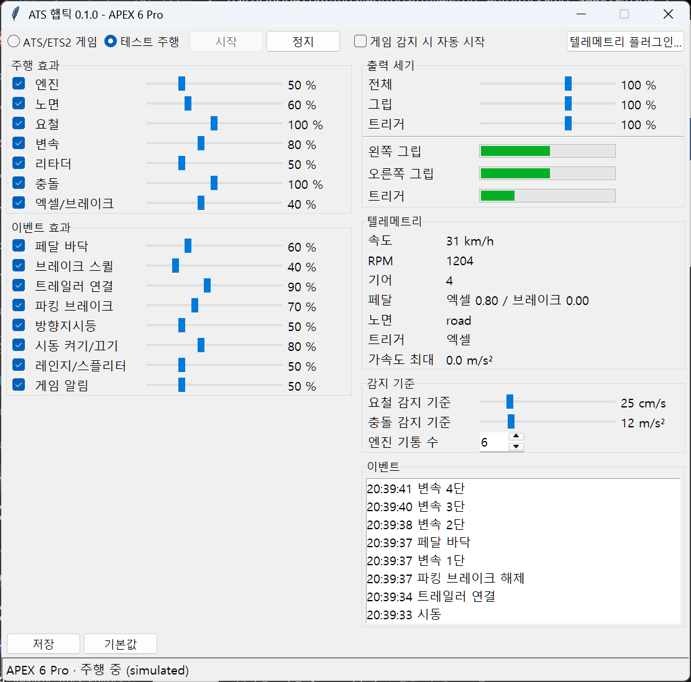
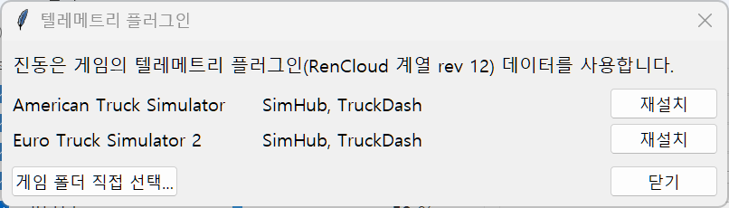

# ATS 触觉反馈 for Flydigi APEX 6 Pro

[한국어](README.md) · [English](README.en.md) · [日本語](README.ja.md) · **简体中文**

用 American Truck Simulator / Euro Truck Simulator 2 的遥测数据直接驱动飞智 APEX 6 Pro（八爪鱼 6 Pro）的 VCM（音圈）电机。与分析游戏声音的 X-Haptics 不同，本程序根据发动机转速、路面、悬挂、踏板等游戏数据生成振动，并可在窗口中实时调节。



> 截图为韩语界面。界面语言跟随 Windows 显示语言，也可以在右上角的语言菜单中切换。

## 目录

- [系统要求](#系统要求)
- [安装与快速上手](#安装与快速上手)
- [界面说明](#界面说明)
- [遥测插件窗口](#遥测插件窗口)
- [随游戏启动 (Steam 启动选项)](#随游戏启动-steam-启动选项)
- [更新](#更新)
- [调校技巧](#调校技巧)
- [故障排除](#故障排除)
- [已知限制](#已知限制)
- [从源码运行与构建](#从源码运行与构建)
- [许可证](#许可证)

## 系统要求

- Windows 10/11
- 飞智 **APEX 6 Pro**（有线或 2.4 GHz 接收器。不支持蓝牙和非 Pro 版 APEX 6）
- American Truck Simulator 或 Euro Truck Simulator 2
- 运行期间请**关闭 xHaptics Engine。** 它输出到同一组电机，振动会混在一起。Space Station 网页只需关闭其标签页即可。

## 安装与快速上手

1. 从 [Releases](../../releases) 下载 `ATSHaptics-<版本>.zip`，解压到任意位置。
2. 运行 `ATSHaptics\ATSHaptics.exe`。无需安装。
3. 如果游戏没有可用的遥测插件，[插件窗口](#遥测插件窗口)会自动打开。请点击**安装**。
4. 先用 **测试驾驶** → **开始** 确认手柄会振动（无需游戏的 60 秒场景）。
5. 选择 **ATS/ETS2 游戏** → **开始**，然后启动游戏。游戏启动后程序会占用手柄，游戏结束后释放。

如果希望每次启动游戏时自动打开窗口，请设置 [Steam 启动选项](#随游戏启动-steam-启动选项)。

## 界面说明

把鼠标在任意滑块、开关、按钮或数值上停留片刻，就会出现说明其作用的提示。提示内容是下表的精简版。

### 顶部栏与输出控制

| 项目 | 说明 |
|---|---|
| **输入: ATS/ETS2 游戏** | 用游戏遥测生成振动。只有在 ATS（`amtrucks.exe`）或 ETS2（`eurotrucks2.exe`）运行时才占用手柄。 |
| **输入: 测试驾驶** | 无需游戏，循环播放一段固定的 60 秒送货路线：启动发动机 → 连接挂车 → 起步车轮打滑 → 加速与换挡（半挡、高低挡）→ 高速公路（左转向灯、左侧坑洼、右侧减速振动带）→ 混凝土接缝 → 碎石路（右转向灯）→ 木桥 → 雪地 → 冰面车轮打滑 → 下坡缓速器与发动机制动 → 急刹车（车轮抱死、刹车尖啸）→ 收费站 → 打开双闪倒车撞上装卸台（碰撞）→ 驻车制动 → 断开挂车 → 送货完成 → 发动机熄火。挂车车轮会在卡车压过颠簸 0.45 秒后跟着压过。用于检查或调校效果。 |
| **▶ 开始 / ■ 停止** | 同一个按钮。点击绿色的 **开始** 开始输出振动，按钮变为红色的 **停止**。停止时关闭电机并释放手柄。运行中无法切换输入（游戏/测试驾驶）。 |
| **检测到游戏时自动开始**（开关） | 打开后，窗口处于停止状态时，游戏一启动就会自动开始。如果在游戏中手动停止，则在该游戏结束前不会再次开始。开关切换后立即保存。 |
| **GitHub ↗** | 在浏览器中打开本程序的 GitHub 仓库（源代码、发布版本、问题反馈）。 |
| **语言菜单**（例如 `简体中文 ▾`） | 选择界面语言：한국어、English、日本語、简体中文、Deutsch、Français、Español、Português (Brasil)、Polski、Русский。界面会立即重绘，调校数值和运行状态保持不变，所选语言立即保存。选择之前跟随 Windows 显示语言，列表中没有的语言则显示英语。状态消息和事件日志也使用同一语言；已经记录的事件行保持原样。 |
| **遥测插件** | 打开[插件窗口](#遥测插件窗口)。 |
| **更新 x.y.z** | 仅当 GitHub 上有更新的发布版本时出现。见[更新](#更新)。 |

### 输出强度与输出仪表

发送到手柄的**最终强度**，在下面各效果的强度全部混合之后应用。范围 0–150%，默认 100%。

| 项目 | 说明 |
|---|---|
| **总体** | 同时作用于握把和扳机。 |
| **握把** | 仅作用于左右握把电机。 |
| **扳机** | 仅作用于扳机电机。设为 0% 时扳机振动完全关闭。 |

输出调大后，多个效果叠加时会有限幅（软限幅器）让其平滑饱和。超过 100% 时，弱的效果会变强，本来就强的效果几乎不变。

**仪表**显示实际输出到左握把 / 右握把 / 扳机的强度。用于在振动偏弱或没有振动时确认是在哪个环节变小的。

### 行驶效果

左侧开关可以逐个打开或关闭效果。关闭的效果整行变灰，但滑块数值和振动位置会保留，重新打开即可恢复。

右侧 **振动位置** 中点击 **握把**（蓝）| **扳机**（橙）| **两者**（紫）之一，为每个效果选择振动输出的位置（行驶效果和事件效果都适用）。滑块颜色也会跟随所选位置的颜色，哪个效果去哪里一目了然。在关闭的效果上点击位置，会以该位置重新打开。表中的"默认输出"是初始设置。有左右之分的效果（路面、颠簸、转向灯）发送到扳机时，左右会合并后输出到扳机；扳机效果发送到握把时，会同样输出到两侧握把。修改立即生效，点击**保存**后保留。

| 效果 | 默认值（范围） | 默认输出 | 内容 |
|---|---|---|---|
| **发动机** | 50%（0–200） | 两侧握把 | 发动机点火频率（rpm ÷ 60 × 缸数 ÷ 2，六缸即 rpm ÷ 20）再加上二次谐波的振动。油门踩得越深、转速越高越强。发动机熄火时没有振动。 |
| **路面** | 60%（0–200） | 左右握把分别输出 | 强度和质感由车轮下的路面材质和车速决定，并叠加悬挂的细微抖动。强度依次为 冰 < 沥青 < 混凝土 < 雪 < 木 < 金属 < 草地 < 泥土 < 碎石。参考真实轮胎录音的低频成分，每种材质的振动高低不同（冰 140 Hz、草地和金属 130 Hz、沥青 100 Hz、碎石 85 Hz、雪 70 Hz、木 65 Hz），车速越慢越低（静止时为 60%）。碎石、泥土、雪和粗糙路面还混有石子弹起的“哒哒”声，大多很小，偶尔有大石子重重一击（碎石路每米约 3 颗）。像录制的路面声一样每秒起伏几次（约 4 Hz），悬挂剧烈运动的崎岖路面上还会混入驾驶室咔哒作响的 55 Hz 冲击，每秒最多 40 次。也区分路面状况（平整路面 `road_smooth` < 普通道路 < 粗糙路面 `road_coarse` < 覆土道路 `road_dirt`）。 |
| **颠簸** | 100%（0–200） | 对应车轮一侧的握把 | 悬挂突然动作时（坑洼、路缘、接缝）输出冲击。参考真实颠簸录音，随冲击大小变化：小接缝是短而高的“咚”（65 Hz、0.025 秒），大坑洼是低而沉的“砰”（40 Hz、0.06 秒），大冲击之后驾驶室会轻轻咔哒约 0.3 秒。左侧车轮到左握把，右侧车轮到右握把。挂车车轮的颠簸以一半强度、稍高一些（+10 Hz）随后出现。 |
| **减速振动带** | 80%（0–200） | 对应车轮一侧的握把 | 压上中线或路肩的减速振动带时发出"嘟噜噜噜"的振动。根据游戏按车轮报告的路面材质（`rumble_stripe`）检测，所以即使悬挂几乎不动也会振动。频率由沟槽间距（约 30 cm）和车速决定，时速 90 km 时约 83 Hz。只有挂车车轮压上时也会以一半强度振动。 |
| **车轮打滑** | 70%（0–200） | 两侧握把 | 踩油门时驱动轮明显比卡车转得快（冰、雪、泥、急起步），输出粗糙刮擦感的 45 Hz 振动，并像轮胎时抓时滑一样以 13 Hz 抖动。刹车导致的车轮抱死由 **油门/刹车** 负责。 |
| **换挡** | 80%（0–200） | 两侧握把 | 换挡时的"咔嚓"。像踩下离合一样，行驶振动中断 0.02 秒，然后以 62 Hz 牢牢咬合，并留下 38 Hz 的余韵。自动变速箱也有效。 |
| **缓速器** | 50%（0–200） | 两侧握把 | 与缓速器挡位成正比的嗡嗡声。车速越快音调越高（静止 40 Hz → 时速 90 km 以上 65 Hz），低速时减弱。发动机制动是按发动机点火节奏（6 缸为 rpm ÷ 20）“哒哒哒”敲击的振动，转速越高越强，踩油门时停止。 |
| **碰撞** | 100%（0–200） | 两侧握把 | 加速度瞬间大幅跳变时（碰撞、大冲击）输出强烈的 50 Hz 脉冲。阈值在[检测阈值](#检测阈值)中设置。 |
| **油门/刹车** | 40%（0–100） | 扳机 | 跟随当前踩下的踏板。油门时是随踏板行程增强的 100 Hz；刹车时，车轮抱死会输出以 12 Hz 断续的 110 Hz 脉冲，未抱死时是与车速和制动量成正比的轻微振动。 |
| **└ 发动机节拍** | 0%（0–100） | 跟随油门/刹车 | 让油门扳机振动随发动机点火节奏起伏的程度。0% 时振动恒定，扳机上完全没有发动机感；调高后节奏越明显（旧版本固定为 80%）。不影响刹车一侧。 |
| **匀速时减弱** | 60%（0–100） | - | 为了在长途匀速行驶时减轻手部疲劳，当转速、油门负荷和踏板保持不变时，**发动机** 和 **油门/刹车** 的振动会在几秒内逐渐减弱到这个比例（约 5 秒减半，10 秒几乎全部）。加速、换挡、松开或重新踩下油门的瞬间会立即恢复原来的强度。60% 时匀速约 −7 dB，80% 约 −12 dB。0% 则不减弱。车轮抱死脉冲是警告，不会减弱。 |

### 事件效果

| 效果 | 默认值 | 默认输出 | 内容 |
|---|---|---|---|
| **踏板** | 60% | 扳机 | 油门或刹车踩到底（97% 以上）的瞬间短促"咚"一下 |
| **刹车尖啸** | 40% | 扳机 | 在约 14 km/h 以下边刹车边慢慢停下时“吱——吱”尖叫的 230 Hz。像真实录音一样每次断续 0.15–0.5 秒，每次音高略有不同 |
| **挂车已连接** | 90% | 两侧握把 | 连接时沉重的"咚"，断开时"咚"之后是放气的感觉 |
| **驻车制动** | 70% | 两侧握把 | 拉起时“咔哒”一声，随后弹簧制动器放气的“嘶——”（0.15 秒内变强，近一秒内消失）；松开时低沉的“咚”，0.3 秒后短促的“噗” |
| **转向灯** | 50% | 亮灯一侧的握把 | 每闪一次"嘀"一下 |
| **发动机启动/熄火** | 80% | 两侧握把 | 启动时先是起动机转动再"嗡"一声，熄火时随之抖动 |
| **高低挡/半挡** | 50% | 两侧握把 | 操作 H 挡的高低挡切换或半挡开关时"咔嗒"。自动/序列式换挡时不会触发。 |
| **游戏通知** | 50% | 两侧握把 | 收费站、罚款、加油、送货完成、渡轮、火车事件时"哒哒"两下 |
| **└ 为事件让位** | 70%（0–100） | - | 事件效果（包括换挡、碰撞）触发的瞬间，暂时减弱同一位置的行驶振动（发动机、路面、减速振动带、车轮打滑、缓速器、油门/刹车），避免事件被淹没的程度。70% 时，事件最强的瞬间行驶振动降到 30%，约 0.1 秒内恢复。0% 则不减弱。颠簸是路面持续产生的效果，不会减弱行驶振动。 |

事件效果的范围均为 0–200%。

### 检测阈值

| 项目 | 默认值（范围） | 说明 |
|---|---|---|
| **颠簸阈值** | 25 cm/s（5–100） | 悬挂突然以超过此速度的速度运动时输出颠簸脉冲。调低会对小颠簸也有反应，调高则只对大冲击有反应。 |
| **碰撞阈值** | 12 m/s²（4–40） | 8 ms 内加速度变化超过此值时输出碰撞脉冲。请设得明显高于平时行驶中[遥测](#遥测)里"最大加速度"的数值。 |
| **发动机缸数** | 6（4–12） | 用于计算发动机振动频率。ATS 原厂卡车大多是直列六缸，ETS2 的 Scania V8 之类的卡车设为 8。遥测中没有缸数信息，所以需要手动指定。 |

### 遥测

当前从游戏接收到的数据。振动异常时，用来确认数据是否正常传入。

| 项目 | 说明 |
|---|---|
| **速度 / RPM / 挡位** | 直接来自游戏。倒挡为负数，空挡为 0。 |
| **踏板** | 油门/刹车输入（0–1）。不包括定速巡航之类由游戏代为施加的数值。 |
| **路面** | 第一个车轮下路面材质的游戏内部名称（例如 `road`、`gravel`、`grass`）。 |
| **扳机** | 扳机通道当前跟随的踏板（油门/刹车/-）。 |
| **最大加速度** | 最近 0.1 秒内水平加速度的最大值。设置碰撞阈值时可作参考。 |

### 事件日志

换挡、碰撞、踏板到底、挂车、驻车制动、转向灯、发动机启动/熄火、游戏通知会连同时间一起记录。手柄连接问题也会记录在这里。最多显示最近 50 条。

### 保存、恢复默认、调试记录与延迟显示

| 项目 | 说明 |
|---|---|
| **保存** | 将滑块、开关状态和振动位置（握把/扳机/两者）保存到 `%APPDATA%\ATSHaptics\config.json`。有未保存的更改时 **保存** 按钮变蓝并显示"已更改 · 未保存"，关闭窗口时会询问是否保存。 |
| **恢复默认** | 把所有强度、阈值和振动位置恢复为默认值，并打开所有效果。保存需要另外点击。 |
| **调试记录**（开关） | 打开后，每次占用手柄时（开始、游戏启动、断线后重新连接）把发送给手柄的每个 8 ms 数据块逐行写入 `%APPDATA%\ATSHaptics\logs\blocks-<日期>-<时间>.csv`。列依次为时间（精确到 ms）、与上一块的间隔（大于 8 ms 表示输出延迟）、扳机路由、扳机/左握把/右握把的最大值（±112 为满幅）、速度/挡位/油门/刹车/路面，以及该块的事件。每小时约 30 MB，只保留最近 10 个文件。开关立即保存，从下次 **开始** 起生效。开始记录时事件日志中会显示文件名。 |
| **记录文件夹 ↗** | 在资源管理器中打开调试记录文件夹。 |
| **上次会话：延迟帧 / 最大 ms**（右侧） | 上一次会话中错过 8 ms 输出周期的次数，以及最长的延迟。接近 0 即为正常。 |

### 状态显示

在输出控制行右侧以 `手柄状态 · 遥测状态` 的形式显示。前面的圆点为绿色表示正在输出，黄色表示已开始但尚未占用手柄（等待游戏等），红色表示错误，灰色表示已停止。

| 消息 | 含义与处理 |
|---|---|
| `已停止` | 未在输出。 |
| `未占用手柄 · 等待游戏（ATS/ETS2 未运行）` | 已开始，但游戏尚未运行。未占用手柄。 |
| `APEX 6 Pro · 行驶中（Local\…Telemetry）` | 正常运行中。括号内是正在读取数据的插件的共享内存名称。 |
| `… · 暂停/菜单` | 游戏已暂停或处于菜单界面。振动停止。 |
| `… · 遥测停止更新（最小化/加载中）` | 游戏数据超过 0.3 秒没有更新。可能正在加载或窗口被最小化。 |
| `… · 等待遥测（游戏加载中或未安装插件）` | 游戏正在运行但没有遥测。如果加载完成后仍然如此，请安装插件。 |
| `无遥测：… 插件版本 N（支持：12）…` | 已安装插件的数据结构版本不匹配。请在插件窗口中安装。 |
| `未找到手柄（请检查有线/2.4G 接收器连接和电源） · 2 秒后重试` | 找不到手柄。请检查连接。程序每 2 秒自动重试。 |
| `看不到手柄：本进程由 Steam 启动，Steam Input 隐藏了手柄 …` | 在 Steam 启动的进程中（例如作为非 Steam 游戏添加的 ATSHaptics），如果该游戏开启了 Steam Input，就看不到手柄。请直接打开窗口，或使用下面的启动选项。 |
| `手柄无响应（如在休眠，请按任意键唤醒）` | 能看到接收器，但手柄没有响应。按键唤醒后会自动继续。 |
| `手柄连接已断开（…）` | 行驶中连接断开。重新连接后会自动继续。 |
| `游戏已退出，已释放手柄` | 游戏已结束，手柄已释放。等待下次启动游戏。 |
| `错误：…` | 无法自动恢复的问题（例如不是 APEX 6 Pro 的型号）。详细内容记录在 `%APPDATA%\ATSHaptics\logs\error.log`。 |

## 遥测插件窗口



振动由游戏中安装的遥测插件（RenCloud scs-sdk-plugin 系列，数据结构 rev 12）输出的数据生成。该窗口会在 Steam 库中查找 ATS/ETS2 的安装文件夹，并显示 `bin\win_x64\plugins` 中有哪些插件。

| 显示 | 含义 |
|---|---|
| `RenCloud`、`TruckDash` | 兼容，直接使用即可。 |
| `SimHub` | SimHub 用的插件。数据结构未经确认，显示为"兼容性未知"。 |
| `无遥测插件` | 请点击 **安装**。 |

- **安装 / 重新安装：** 将随附的 RenCloud `scs-telemetry.dll`（v1.12.1，MIT）复制到游戏的 `plugins` 文件夹。不会改动其他插件。如果游戏正在运行，将在下次启动时生效。
- **手动选择游戏文件夹…：** 非 Steam 安装或未能找到时，指定游戏文件夹（包含 `bin\win_x64\amtrucks.exe` 或 `eurotrucks2.exe` 的文件夹）。
- 如果没有写入游戏文件夹的权限，错误窗口会列出需要复制的文件和位置。请以管理员身份运行，或手动复制。
- 有插件时，游戏启动时可能会出现"Advanced SDK features"提示。这表示遥测插件已正常加载。

## 随游戏启动 (Steam 启动选项)

在 Steam 库中打开游戏的 **属性 → 通用 → 启动选项**，输入如下内容。路径请改为解压的位置。

```
"C:\Tools\ATSHaptics\ATSHaptics.exe" --launch %command%
```

- 启动游戏时窗口会**以最小化状态一同打开并自动开始**。关闭游戏时窗口也会关闭。有未保存的更改时会先询问。
- 没有常驻程序。只在窗口打开期间每 2 秒检查一次游戏是否在运行。
- 已有的启动选项（例如 `-nointro`、`-rdevice dx11`）放在 `%command%` 后面。
- 如果窗口已经打开，不会出现第二个窗口；若已打开的窗口处于停止状态，则以 **ATS/ETS2 游戏** 输入开始（与自动开始开关无关）。该窗口在游戏结束后不会关闭。
- 窗口在 Steam 启动的进程之外（通过 WMI）打开。因为 Steam 会向游戏及其子进程注入覆盖层，并在游戏开启 Steam Input 时对这些进程隐藏手柄。这样即使开着 Steam Input 也能占用手柄。

## 更新

打开窗口时会在 GitHub 上检查最新发布版本。有更新版本时，右上角会出现 **更新 x.y.z** 按钮。离线时会静默跳过。

- 点击按钮会显示发布说明，确认后下载 zip，并检查其是否与 GitHub 公布的 SHA-256 一致。
- 下载后窗口关闭（有未保存的更改时会先询问），程序完全退出后，新文件会覆盖到安装文件夹，并重新启动新版本。设置（`%APPDATA%\ATSHaptics`）保持不变。
- 覆盖前会先备份安装文件夹；复制失败时会恢复到旧版本再启动。如果 2 分钟后程序仍未退出，则不做任何更改。
- 游戏运行期间不会更新。通过 Steam 启动选项打开时，可执行文件在游戏结束前一直处于使用状态。请退出游戏后重新打开窗口再更新。
- 如果没有写入安装文件夹的权限（例如 `Program Files`），或从源码运行，则只打开发布页面。
- 安装过程记录在 `%TEMP%\ATSHaptics-update-<版本>\unpacked\apply-update.log`。

## 调校技巧

1. 从 **测试驾驶** 开始，一边看输出仪表一边确定总体强度。
2. 在实际驾驶中逐个打开和关闭效果进行比较。开关立即生效。
3. 如果长途行驶时发动机或扳机振动让手疲劳，在降低强度之前先把 **匀速时减弱** 调到 70–90% 试试。匀速路段会变安静，而加速、换挡等操作瞬间的手感保持不变。仍然觉得干扰的话，把 **发动机** 降到 20–30%。
4. 如果扳机对手指负担太大，请降低 **输出强度 → 扳机**。各效果之间的比例保持不变。
5. 想用手指感受某个效果（例如在油门扳机上感受发动机振动），把该效果的振动位置改为 **扳机** 或 **两者**。
6. 如果在铺装路面上颠簸脉冲过于频繁，请调高 **颠簸阈值**。
7. 如果行驶中转向灯、换挡等事件不容易感觉到，请调高 **为事件让位**，或降低 **发动机**、**路面**。如果不喜欢每次事件时行驶振动起伏的感觉，请调低让位。
8. 满意后点击 **保存**。

## 故障排除

**完全没有振动。**
- 确认状态显示是否为 `APEX 6 Pro · 行驶中`。如果是其他消息，请查看[状态显示表](#状态显示)。
- 如果 xHaptics Engine 正在运行，请关闭它。
- 如果输出仪表在动但没有振动，请检查输出强度和手柄的连接方式（不支持蓝牙）。

**启动游戏后没有振动，重启程序后才正常。** 这是 0.1.0 的问题。游戏或 Steam 在加载时初始化手柄，或手柄休眠后重新与接收器配对时，手柄固件会丢失电机设置；而此时数据发送仍然没有报错，所以没有触发重试。现在输出期间会定期重新发送电机设置（安静时每 1 秒，振动时每 4 秒），几秒内就会自动恢复。

**遥测数值只显示 `-`。**
- 确认游戏是否处于暂停/菜单状态。
- 在插件窗口中确认是否有兼容插件（RenCloud、TruckDash），没有的话安装后重新启动游戏。

**两个扳机都在振动。** 这是手柄的限制。见[已知限制](#已知限制)。

**从 Steam 启动游戏时窗口没有打开。**
- 检查启动选项中的路径和引号。
- 如果已经有窗口打开，不会出现新窗口（请查看任务栏）。

**文字显示为错误的语言。** 在右上角的语言菜单中选择。所选语言保存在 `config.json` 的 `app.language` 中，删除该值后会重新跟随 Windows 显示语言。

**想重置设置。** 点击 **恢复默认** → **保存**，或删除 `%APPDATA%\ATSHaptics\config.json`。

**振动偶尔会异常跳动。** 打开下方的 **调试记录**，重新点击 **开始**，跳动时看一下时钟记住时间。在该时间附近的行中，如果 `gap_ms` 明显大于 8，说明输出延迟了；如果 `trigger`/`left_grip`/`right_grip` 的数值突然变大，说明是本程序发出的。两者都正常的话，原因在程序之外（无线干扰、游戏或 Steam Input 的振动、固件）。反馈问题时请一并发送该文件和时间。

**想收集反馈问题所需的信息。** 运行 `ATSHaptics.exe --selftest`，会在 `%TEMP%\ATSHaptics-selftest.txt` 中记录版本、手柄识别以及游戏/插件检测结果。如果状态显示出现了 `错误：…`，请同时发送 `%APPDATA%\ATSHaptics\logs\error.log`，其中记录了意外错误及其时间。

## 已知限制

- 扳机通道只有一个，因此会不分左右地**同时振动两侧扳机**。握把左右独立。已在手柄固件 9.0.5.5 上用 `tone.py split`（与基准音对比的盲测）确认：无论把路由指定为左或右，还是每个数据块交替发送，两侧扳机的感觉都一样。飞智 Space Station 和 X-Haptics 也把扳机作为一个不分左右的部位处理。
- 遥测中没有发动机缸数、雨刷速度等信息，相关效果需要手动设置或未包含。
- 基于非官方的逆向工程，手柄固件更新可能会改变其行为。

## 从源码运行与构建

```powershell
python -m venv .venv
.\.venv\Scripts\python.exe -m pip install -r requirements.txt
.\.venv\Scripts\pythonw.exe app.py                    # 窗口（或 start_gui.cmd）
.\.venv\Scripts\python.exe ats_haptics.py --monitor   # 命令行：--simulate, --exit-with-game, 各效果强度选项
.\.venv\Scripts\python.exe tone.py probe              # 诊断：probe | tone | sweep | walk | route-test | diag | split
.\.venv\Scripts\python.exe tone.py split              # 扳机左右分离盲测，结果保存在 logs\trigger-split-*.txt
powershell -ExecutionPolicy Bypass -File build.ps1    # dist\ATSHaptics-<版本>.zip（含源码）
.\.venv\Scripts\python.exe i18n.py                  # 翻译检查：缺失、未使用或 {占位符} 不一致的文本
.\.venv\Scripts\python.exe -m unittest              # 回归测试（tests\）
```

界面文本以代码中的韩语原文作为键（`t("정지됨")`）。翻译位于 `locales\<语言>.py` 的 `MESSAGES` 中，缺少翻译时依次回退到英语、韩语。修改或新增文本后，请运行 `i18n.py` 确认所有语言表都已更新。

从源码运行时的 Steam 启动选项：`"<repo>\.venv\Scripts\pythonw.exe" "<repo>\launch.py" %command%`

结构：

```
ATS ─(scs-telemetry 共享内存)─▶ telemetry.py ─▶ effects.py (1 kHz 合成) ─▶ apex6.py ─(HID 0x57, 8 ms)─▶ APEX 6 Pro
                                  gamewatch.py：游戏运行检测       plugin_install.py：插件检测与安装
                                  updater.py：GitHub 发布检查与自动更新
                                  i18n.py + locales\：界面语言     gui.py + widgets.py：窗口、提示
                                  blocklog.py：调试记录            errorlog.py：意外错误记录
```

## 许可证

GPL-3.0-or-later（`LICENSE`）。APEX 6 协议实现移植自 [ApexSenseBridge](https://github.com/ReynArts/ApexSenseBridge)（GPL-3.0-or-later），随附的遥测插件为 [RenCloud/scs-sdk-plugin](https://github.com/RenCloud/scs-sdk-plugin)（MIT）。详情见 [THIRD_PARTY_NOTICES.md](THIRD_PARTY_NOTICES.md)。发布 zip 中的 `source\` 文件夹包含对应的源码。

本项目为非官方项目，与飞智及 SCS Software 无关。
